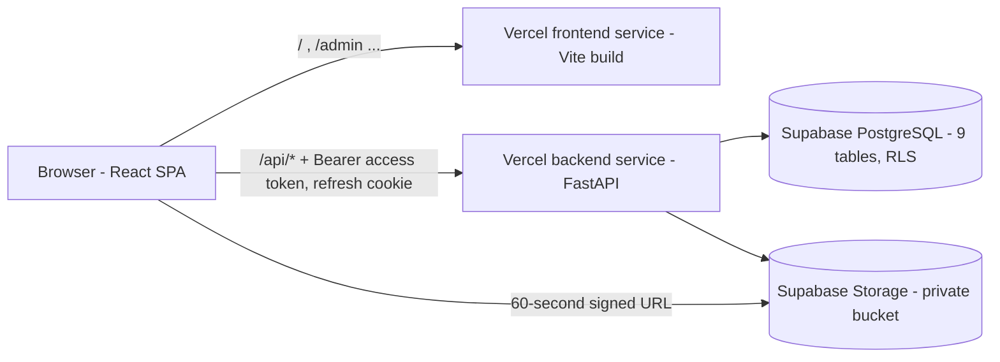

# PrintPoint — Campus Printing Management System

[](https://react.dev/)
[](https://fastapi.tiangolo.com/)
[](https://supabase.com/)
[](https://2331428.vercel.app)

PrintPoint moves a university print shop online. Students upload a PDF or DOCX, choose pages, copies and black-&-white or colour, **see the price before submitting** and track the job until they collect it. Print-shop staff work from one digital queue, move jobs through a fixed workflow, record payment and administer the system from an admin dashboard. Teams can share print jobs through groups whose owner decides what each member may do.

CSE309 Web Application & Internet — Final Project, Autumn 2026 · Student ID 2331428.

> **Status:** complete and live. JWT authentication with refresh and logout, RBAC with ownership and group permissions, admin dashboard, audit log, printing cost and payment tracking, dark/light mode — deployed on Vercel with Supabase PostgreSQL.

## Contents

[Live links](#-live-links) · [Test accounts](#-test-accounts-for-the-instructor) · [Problem and objectives](#-problem-and-objectives) · [Features](#-features) · [Tech stack](#️-tech-stack) · [Architecture](#️-architecture) · [How it works](#-how-it-works) · [Run locally](#-run-locally) · [Environment variables](#️-environment-variables) · [API](#-api) · [Tests](#-tests) · [Deploy](#️-deploy-to-vercel) · [Documentation](#-documentation) · [Troubleshooting](#-troubleshooting)

## 🔗 Live links

| What | URL |
|---|---|
| Frontend | https://2331428.vercel.app |
| API base | https://2331428.vercel.app/api |
| API docs (Swagger UI) | https://2331428.vercel.app/api/docs |
| Health check | https://2331428.vercel.app/api/health |
| Final report (Markdown) | [docs/FINAL_REPORT.md](docs/FINAL_REPORT.md) |
| Final report (PDF, with screenshots) | [docs/FINAL_REPORT.pdf](docs/FINAL_REPORT.pdf) |

The live app is built from the `main` branch. Data is stored in a hosted **Supabase PostgreSQL** database and documents in a private **Supabase Storage** bucket, so everything survives restarts.

## 👥 Test accounts (for the instructor)

Passwords are **not** in this repository — they are provided only in the submission form / submitted PDF.

| User ID (e-mail) | Role | What to try |
|---|---|---|
| `demo.admin1@uni.edu` | admin (Print-Shop Staff) | Dashboard, Staff Queue, Users, All Groups, Moderation, Audit Log, CSV export |
| `demo.admin2@uni.edu` | admin (Print-Shop Staff) | second admin — shows that an admin cannot ban another admin |
| `demo.student1@uni.edu` | user (Student) | owner of the shared group |
| `demo.student2@uni.edu` | user (Student) | group member: can create + edit, cannot assign |
| `demo.student3@uni.edu` | user (Student) | group member: view only |

### Shared group: `CSE309 Project Team`

| Member | View | Create | Edit | Assign | Rename / delete group, manage members |
|---|:-:|:-:|:-:|:-:|:-:|
| demo.student1 (owner) | ✅ | ✅ | ✅ | ✅ | ✅ (owner only) |
| demo.student2 | ✅ | ✅ | ✅ | ❌ | ❌ |
| demo.student3 | ✅ | ❌ | ❌ | ❌ | ❌ |

Admins are **not** members of the group: they have no group powers and see it only through the admin *All Groups* / moderation pages.

### Sample data

Seeded with `backend/scripts/seed_demo.py` (costs calculated by the server):

| Request | Owner | Pages × copies, type | Cost | Status | Payment |
|---|---|---|---|---|---|
| Lab Report 3 | student1 | 12 × 1, B&W | Tk 24 | Pending | Unpaid |
| Project Proposal (group, assigned to student2) | student1 | 8 × 4, Color | Tk 320 | Processing | Paid |
| Survey Questionnaire (group) | student2 | 2 × 30, B&W | Tk 120 | Ready | Paid |
| Curriculum Vitae | student2 | 2 × 3, Color | Tk 60 | Collected | Paid |
| Lecture Slides Week 9 | student3 | 40 × 1, B&W | Tk 80 | Rejected (with reason) | Unpaid |
| Assignment 2 | student3 | 6 × 2, B&W | Tk 24 | Pending | Unpaid |

The live database may contain more requests created while testing the site.

## 🎯 Problem and objectives

**Problem.** Students hand files to the print shop on USB sticks or by message, wait at the counter, and cannot tell when a job is ready; staff calculate prices by hand and keep no record of payment; team printing is coordinated informally.

**Objectives.**
1. Submit and track print jobs online, with document upload.
2. Show a transparent, server-calculated price (B&W **Tk 2**/page, Colour **Tk 10**/page).
3. Give staff one queue with a fixed status workflow and payment tracking.
4. Keep every student's data private (no user can read another user's records).
5. Let teams share jobs with owner-controlled permissions.
6. Give admins full user and content management with an audit trail.

## 🚀 Features

**Students (role `user`)**
- Sign up, log in, stay logged in (silent refresh), log out; see and revoke sessions; update profile; change password (current password required).
- Create print requests: document name, **pages**, copies, print type, notes, optional group, PDF/DOCX upload (≤ 4 MB, private storage).
- **Live price estimate** in the form; the server recalculates and stores `total_cost` (the browser's price is never trusted).
- Edit or delete a request only while it is **Pending and unpaid**; see status history and rejection reasons; download own documents through short-lived signed links.
- See only own requests and requests of own groups — any other ID returns 404.
- **Groups:** create a group, add members and set **Create / Edit / Assign** per member; only the owner renames, deletes or manages members.

**Print-shop staff (role `admin`)**
- **Staff queue:** status tabs with counts, search, filters (type, payment, has file, date range), oldest-first sorting.
- **Workflow:** `Pending → Processing → Ready → Collected` or `Pending → Rejected` (reason required); full status history.
- **Payment:** *Mark as paid (Tk X)* / *Undo paid*; Rejected requests cannot be marked paid; every change is audited.
- **Admin dashboard:** statistics; failed-login security view by IP and account.
- **Users:** search, role/status filters, pagination, user detail (requests, groups, sessions, activity), ban/unban with reason, bulk ban/unban, change role, revoke sessions.
- **All Groups:** every student's group with owner, members, permissions and requests; delete or bulk delete.
- **Moderation:** delete any request or group (single or bulk), audited.
- **Audit log:** filters by event, user, IP, text and date; CSV export of users, requests (incl. cost and payment) and activity.

**Everyone:** 🌙 / ☀️ dark and light mode on every page, remembered across reloads.

## 🛠️ Tech stack

| Part | Choice |
|---|---|
| Frontend | React 19, TypeScript, Vite, React Router |
| Backend | Python 3.12, FastAPI, SQLModel / SQLAlchemy, Pydantic |
| Auth | PyJWT (HS256 access tokens), argon2-cffi (Argon2id + pepper), httpOnly refresh cookie |
| Database | Supabase PostgreSQL (psycopg 3, pooler), Alembic migrations; SQLite for quick local runs and tests |
| File storage | Supabase Storage, private bucket `print-documents`, signed URLs |
| Tests | pytest + FastAPI TestClient (backend), Node built-in test runner (frontend) |
| Hosting | Vercel — one project, two services (FastAPI + Vite) on one domain |

## 🏗️ Architecture



```
backend/
  main.py            FastAPI app, CORS, error handlers, /api/health, /api/docs
  config.py          settings from environment (refuses missing/weak secrets on Vercel)
  database.py        engine (Supabase pooler or local SQLite) + session dependency
  models.py          tables;  schemas.py  request/response models
  rbac.py            RBAC module: permissions, require_permission, ownership, groups, admin rules
  crud.py            print-request logic: workflow, payment, history, audit
  pricing.py         printing rates and cost calculation
  documents.py / storage.py   upload validation / private Supabase Storage
  audit.py           activity-log helper
  auth/              router, service (signup/login/refresh/logout), security (hashing), tokens (JWT), dependencies
  routers/           print_requests.py, groups.py, admin.py
  migrations/        Alembic revisions 0001 … 0004
  scripts/           create_admin, seed_demo, setup_storage_bucket, run_with_env
  tests/             pytest suites
frontend/src/
  App.tsx            routes + guards (RequireAuth, GuestOnly, RequireAdmin)
  auth/              AuthContext (access token in memory, silent refresh), guards
  api/               typed API clients (retry once on 401 after refresh)
  components/, pages/  student pages, staff queue, admin dashboard pages
  theme.ts           light/dark theme logic
docs/                FINAL_REPORT.md, FINAL_REPORT.pdf, assets/screenshots/, mid-project PRD/SRS/TDD
vercel.json          /api/* → FastAPI, everything else → Vite (SPA fallback to index.html)
```

## 🔍 How it works

### Frontend
A React single-page app. Pages call typed clients in `src/api/`; `AuthContext` keeps the access token **in memory only** and restores the session on load by calling `/api/auth/refresh` (the refresh token is an httpOnly cookie the page cannot read). On a 401 the client refreshes once and retries. Route guards only decide what is shown — the server enforces every rule. Every print request from the API carries a `permissions` object (`view, edit, delete, change_status, assign, update_payment`), so the UI shows exactly the buttons the server will accept.

### Backend
FastAPI routers → `get_current_user` (verify JWT, reload the user, reject banned or revoked sessions) → `rbac.py` checks → `crud.py` → audit log. All authorization lives in **one module, `backend/rbac.py`**: permission constants, a role → permission map, the reusable `require_permission(...)` dependency, ownership/visibility checks (invisible records return 404) and admin safety rules (no self-ban, no banning admins, no changing own role).

### Logging in (JWT)
| Topic | Implementation |
|---|---|
| Passwords | Argon2id( HMAC-SHA256(`PASSWORD_PEPPER`, password) ), random salt per hash; ≥ 10 chars with a letter and a digit |
| Access token | JWT HS256, ≤ 15 min; claims `sub`, `role`, `sid`, `type`, `iat`, `exp`, `jti` |
| Refresh token | random 256-bit value in httpOnly cookie `pp_refresh` (path `/api/auth`, SameSite=Lax, Secure on HTTPS); only its SHA-256 hash is stored; rotated on every refresh, reuse revokes the session |
| CSRF | `/refresh` and `/logout` require `X-Requested-With: XMLHttpRequest`; CORS limited to the frontend origin |
| Logout / revoke | session revoked → refresh cookie and access token stop working immediately |
| Brute force | account locked 15 min after 5 wrong passwords; 20 failures per IP in 15 min → 429; generic error message |
| Bans / role changes | user reloaded from the database on every request → applies on the very next request |

### Print request workflow and payment
`Pending → Processing → Ready → Collected` or `Pending → Rejected` (reason required). Only staff change status or payment. `total_cost = pages × copies × rate` (B&W Tk 2, Colour Tk 10) is calculated in `backend/pricing.py`; a paid request can no longer be edited and a rejected one cannot be marked paid.

### Database and storage
Nine PostgreSQL tables (`users`, `refresh_sessions`, `login_attempts`, `audit_logs`, `groups`, `group_members`, `print_requests`, `print_request_status_history`, `alembic_version`), Row Level Security on all of them. Documents are validated by content (magic bytes), stored in a private bucket and downloaded through 60-second signed URLs after a permission check.

## 📋 Requirements

- Python 3.12+
- Node.js 22.18+ (or 24)
- Git
- Optional: a Supabase project (PostgreSQL + Storage). Without `DATABASE_URL` the backend uses a local SQLite file; uploads need Supabase Storage.

## 💻 Run locally

### First time
```bash
git clone https://github.com/JannatulFerdous24/2331428_PrintPoint-Campus-Printing-Management-System.git
cd 2331428_PrintPoint-Campus-Printing-Management-System

# Backend
cd backend
python -m venv .venv
.venv\Scripts\activate            # macOS/Linux: source .venv/bin/activate
pip install -r requirements.txt
copy .env.example .env            # macOS/Linux: cp .env.example .env  — then fill in values
alembic upgrade head              # create / update the database schema
python scripts/create_admin.py --email you@example.com --name "Your Name"   # first admin (asks for a password)
uvicorn main:app --reload --port 8000

# Frontend (second terminal)
cd frontend
npm install
npm run dev                       # http://localhost:5173 (proxies /api to :8000)
```

### Running again
```bash
cd backend && .venv\Scripts\activate && uvicorn main:app --reload --port 8000
cd frontend && npm run dev
```

### Demo data (optional)
```bash
cd backend
python scripts/seed_demo.py                                   # dry run: shows what would be created
python scripts/seed_demo.py --execute --out ..\..\demo-accounts.txt   # file must be OUTSIDE the repo
```
Creates the 5 demo accounts, the shared group and 6 sample requests; refuses to run if they already exist. Generated passwords are written only to the `--out` file.

### Database migrations
| Revision | Change |
|---|---|
| `0001_create_print_requests` | mid-project `print_requests` table |
| `0002_core_security_schema` | users, sessions, login attempts, audit log, groups, members, status history, RLS |
| `0003_owner_required` | every print request must have an owner |
| `0004_cost_and_payment` | `pages`, `total_cost`, `payment_status`, `paid_at` (+ cost back-fill) |

`alembic upgrade head` applies them; `alembic upgrade head --sql` previews the SQL without connecting.

### Making someone an admin
Signup only ever creates students. Use `python scripts/create_admin.py …` or, as an admin, *Users → Make staff/admin*.

## ⚙️ Environment variables

Names only — copy [`backend/.env.example`](backend/.env.example) to `backend/.env` (git-ignored). In production they are set in Vercel → Settings → Environment Variables (Production).

| Variable | Purpose |
|---|---|
| `DATABASE_URL` | Supabase transaction pooler (port 6543) used by the app; empty locally = SQLite |
| `MIGRATION_DATABASE_URL` | Supabase session pooler (port 5432), used by Alembic only (local) |
| `JWT_SECRET` | signs access tokens (≥ 32 characters) |
| `PASSWORD_PEPPER` | server-side secret mixed into every password hash (≥ 32 characters) |
| `ACCESS_TOKEN_MINUTES` | access token lifetime, 1–15 (default 15) |
| `REFRESH_TOKEN_DAYS` | refresh session lifetime (default 7) |
| `COOKIE_SECURE` | `true` on HTTPS (always forced on Vercel) |
| `CORS_ORIGINS` | allowed frontend origin(s), comma-separated |
| `SUPABASE_URL`, `SUPABASE_SERVICE_ROLE_KEY`, `SUPABASE_STORAGE_BUCKET` | private document storage (backend only, never in the frontend) |

## 📡 API

Interactive documentation: **https://2331428.vercel.app/api/docs** (Swagger UI; click *Authorize* and paste an access token).

| Area | Endpoints |
|---|---|
| Health | `GET /api/health` |
| Auth | `POST /api/auth/signup`, `/login`, `/refresh`, `/logout`; `GET /api/auth/me`; `GET /api/auth/sessions`, `DELETE /api/auth/sessions/{id}`, `POST /api/auth/sessions/revoke-others` |
| Account | `GET/PATCH /api/users/me`, `POST /api/users/me/password` |
| Print requests | `GET/POST /api/print-requests`, `GET /pricing`, `GET/PUT/PATCH/DELETE /{id}`, `GET /{id}/history`, `PUT/GET /{id}/document`, `PATCH /{id}/assignee`, `PATCH /{id}/payment` (staff) |
| Groups | `GET/POST /api/groups`, `GET/PATCH/DELETE /api/groups/{id}`, `POST /api/groups/{id}/members`, `PATCH/DELETE /api/groups/{id}/members/{user_id}` |
| Admin | `/api/admin/stats`, `/users` (+ `/{id}`, ban, unban, bulk-ban, bulk-unban, role, revoke-sessions), `/groups` (+ `/{id}`, bulk-delete), `/print-requests/{id}` + bulk-delete, `/audit-logs`, `/security/failed-logins`, `/export/users.csv`, `/export/print-requests.csv`, `/export/audit-logs.csv` |

Errors are JSON: `{"detail": "..."}` — 401 (not logged in / bad or expired token), 403 (not allowed), 404 (not found or not yours), 409 (conflict), 422 (validation), 429 (too many attempts).

## 🧪 Tests

```bash
cd backend && python -m pytest -q      # 148 passed, 20 skipped (PostgreSQL integration tests run with RUN_PG_INTEGRATION=1)
cd frontend && npm test                # 7 passed (theme logic)
```

Covered: signup rules, hashing, login, lockout, missing/invalid/tampered/expired tokens (401), refresh rotation and reuse, logout, sessions; RBAC (own vs other records, admin-only endpoints, group permission matrix, owner-only actions, admin safety rules, banned users); workflow; uploads; cost and payment; admin dashboard, all-groups, moderation and CSV; migrations; configuration safety. The deployed site was also verified end to end — see the [final report](docs/FINAL_REPORT.md#c11-testing).

## ☁️ Deploy to Vercel

1. Import the GitHub repository into Vercel (one project). `vercel.json` defines two services — `backend` (FastAPI, `main:app`) and `frontend` (Vite) — routes `/api/*` to the backend and everything else to the frontend, which falls back to `index.html` so deep links like `/admin/users` reload correctly.
2. Add the environment variables above to the **Production** environment.
3. Apply migrations to the production database (`alembic upgrade head` with `MIGRATION_DATABASE_URL`).
4. Push to `main` (or click *Redeploy*). Check `/api/health` and `/api/docs`.

## 📚 Documentation

| Document | Contents |
|---|---|
| [Final report (Markdown)](docs/FINAL_REPORT.md) | Executive summary, PRD, SRS, TDD, evidence, testing, limitations |
| [Final report (PDF)](docs/FINAL_REPORT.pdf) | Same report, formatted, with screenshots of the live application |
| [Screenshots](docs/assets/screenshots/) | Genuine captures of https://2331428.vercel.app |
| [PRD](docs/PRD.md) · [SRS](docs/SRS.md) · [TDD](docs/TDD.md) | Mid-project documents (kept for history) |

## 🩺 Troubleshooting

| Problem | Fix |
|---|---|
| API returns 500 `FUNCTION_INVOCATION_FAILED` on Vercel | an environment variable is missing; the log says which (e.g. `DATABASE_URL is not set`). Add it to Production and redeploy. |
| `JWT_SECRET is missing or shorter than 32 characters` at startup | use at least 32 random characters for `JWT_SECRET` and `PASSWORD_PEPPER` |
| CORS error in the browser | add the frontend origin to `CORS_ORIGINS` |
| Upload fails with 503 "Document storage is not configured" | set the `SUPABASE_*` storage variables |
| Account locked | wait 15 minutes, or an admin checks *Dashboard → Security* |

## 📄 License

MIT — see [LICENSE](LICENSE).
